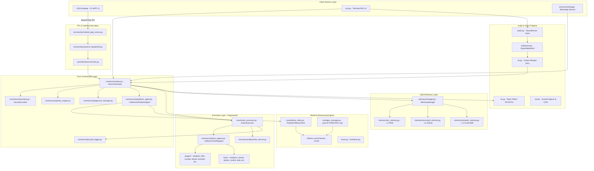

# CURRENT_ARCHITECTURE.md — SON V3 Current State Architecture Audit

**Repository**: `C:\AI\SON`  
**Date of Audit**: November 14, 2026  
**Auditor**: Principal Software Architect & Windows Systems Engineer  
**Status**: Comprehensive Baseline Established (267/267 Python Tests Passing, 15/15 C# .NET Tests Passing)

---

## 1. Executive Summary

SON is an offline-first, local AI assistant on Windows 11 targeting an **AMD Ryzen 7 7840HS** CPU (8C/16T), **NVIDIA RTX 4060 Laptop GPU** (8 GB VRAM), and **16 GB DDR5 RAM**.

The system has evolved across multiple architectural iterations, resulting in two coexisting software designs:
1. **Legacy Voice Assistant Track**: A monolithic root layer centered around `son.py`, `brain.py`, `commands.py`, `config.py`, `memory.py`, and direct Win32 shell scripting in `tools/windows_control.py`.
2. **Defensive V3 Orchestration Track**: A centralized layer centered on `core/orchestrator.py` (`SonOrchestrator`), `core/security/` (SecurityContext, DefensiveToolRegistry, PolicyEngine, ApprovalManager), `core/interfaces/` (InterfaceRequest/Response contracts), `services/ipc/` (Win32 Named Pipe server), and a high-performance C# WPF client (`SON.Desktop`).

The application is fully functional today with zero test regressions, but exhibits architectural duality, tool routing fragmentation, and missing Tier 1 (MCP) and Tier 3 (UIAutomation) abstractions.

---

## 2. High-Level System Architecture Diagram

---

## 3. Detailed Component Inventory

### 3.1 Client Surfaces
- **`SON.Desktop/` (WPF .NET 8, C#)**:
  - Full-featured dark glass desktop HUD with 11 workspace views (Home, Chat, Voice, Memory, Vision, Automation, Files, Code, Tasks, Security, Settings).
  - Connects to Python via Win32 Named Pipe (`\\.\pipe\son_desktop_ipc`).
  - Supports Windows 11 Snap Layouts (`HTMAXBUTTON`), dual-state minimize to taskbar + mini companion HUD, and hardware telemetry graphing.
- **`son.py` (CLI + Rich Terminal UI)**:
  - Command-line entry point supporting `--voice`, `--wakeword`, `--scan`.
  - Runs synchronous conversational loop with terminal status panels.
- **`services/whatsapp/` (FastAPI + Webhook)**:
  - Two-stage confirmation pipeline for voice-drafted WhatsApp messaging.

### 3.2 Core Orchestration & Security
- **`core/orchestrator.py` (`SonOrchestrator`)**:
  - The single authority mediating interface requests, context extraction, policy gating, tool execution, and response synthesis.
- **`core/security/context.py`**:
  - Immutable `SecurityContext` carrying `user_id`, `session_id`, `interface_type`, `risk_tier`, and cryptographically signed tokens.
- **`core/security/policy_engine.py` & `core/security/policy.py`**:
  - Four risk tiers: `READ/OBSERVE`, `LOCAL REVERSIBLE MUTATION`, `HIGH-IMPACT / IRREVERSIBLE`, and `DENIED`.
- **`core/security/approval_manager.py`**:
  - Cryptographic one-time approval tokens bound to action, user, session, and argument hash.
- **`core/security/tool_registry.py`**:
  - Central tool registry validating Pydantic schemas, permissions, risk tiers, and execution handlers.
- **`core/security/audit_logger.py`**:
  - Append-only structured JSONL audit logger (`logs/security_audit.jsonl`) with automated secret redaction.

### 3.3 Execution Layer
- **`core/action_executor.py`**:
  - Dispatches tool invocations, enforces argument validation, deduplicates concurrent desktop calls, and executes dangerous actions inside the E2B sandbox.
- **`plugins/`**:
  - `windows.py`: App management, window management (`open_application`, `close_application`, `minimize_window`, `maximize_window`, `snap_window`), volume/brightness control.
  - `files.py`: Path operations (`search_files`, `copy_path`, `move_path`, `delete_path`, `compress_folder`, `extract_zip`).
  - `vscode.py`: VS Code workspace launcher, `.venv` creation, dependency installation, git commit runner.
  - `docker.py`: Docker container inspection and lifecycle.
  - `browser.py`: URL opening with SSRF localhost/RFC1918 guard.
  - `spotify.py` & `weather.py`: Media control and localized weather.
- **`tools/windows_control.py`**:
  - 1,347 lines of Win32 user32, powershell, and process utilities. Contains overlaps with `plugins/windows.py`.

### 3.4 Memory Subsystem
- **`memory/manager.py` (`MemoryManager`)**:
  - **L1 RAM**: `memory/ram_memory.py` (working conversation context, 12-turn deque).
  - **L2 SQLite**: `memory/structured_memory.py` (`memory/son_structured.db` with WAL mode, storing facts, user preferences, episodic events, and audit logs).
  - **L3 ChromaDB**: `memory/semantic_memory.py` (`memory/chroma.sqlite3` vector embeddings via `nomic-embed-text` for long-term document and conversation recall).

### 3.5 AI Runtime & Hardware Management
- **`core/gpu_manager.py`**:
  - Monitors RTX 4060 VRAM using `pynvml` at microsecond speed; enforces 95% hardware utilization ceiling and prevents CUDA OOM.
- **`core/ollama_client.py`**:
  - Resilient wrapper with exponential backoff retry and TTFT latency measurement.
- **`audio.py`, `stt.py`, `tts.py`, `wakeword.py`**:
  - Audio capture via `sounddevice`.
  - Wake word detection via `openwakeword` ("Hey SON").
  - STT via `faster-whisper` (medium/large-v3, float16 GPU).
  - TTS via `piper-tts` (ONNX GPU/CPU double-buffered synthesis).
- **`native/`**:
  - `son_accel.c` compiled C-extension `_son_accel.cp313-win_amd64.pyd` and `native/son_native.py` (Numba LLVM JIT for SIMD audio RMS, resampling, and cosine similarity).

---

## 4. Current State Weaknesses & Architectural Debt

1. **Dual Track Redundancy**:
   - `brain.py` (root) vs `core/brain.py`
   - `config.py` (root) vs `core/config.py`
   - `commands.py` (root) vs `core/orchestrator.py`
   - `memory.py` (root) vs `memory/manager.py`
   - `tools/registry.py` vs `core/security/tool_registry.py`
2. **Missing Four-Tier Router Abstraction**:
   - Actions jump directly from Orchestrator into whatever Python function happens to be registered in `tool_registry`.
   - No formal Tier 1 (Native API & MCP) discovery and client connector.
   - No formal Tier 2 (Controlled PowerShell/Shell sandbox with strict allowlists).
   - No formal Tier 3 (Windows UI Automation with accessibility trees).
   - Tier 4 (Visual Computer Use) is purely screenshot-to-LLM without coordinate grounding or verification.
3. **No Declarative Skill Packaging**:
   - Tools are hardcoded Python files without declarative manifests (`SKILL.md`), parameter validation metadata, or isolated testing harnesses.
4. **VRAM Contention Under Multi-Model Pressure**:
   - If Ollama loads an 8B model, Whisper allocates 1.5 GB, and Piper ONNX loads simultaneously, VRAM reaches ~7.5 GB on an 8 GB card. Dynamic on-demand model unloading is not yet fully orchestrated.
