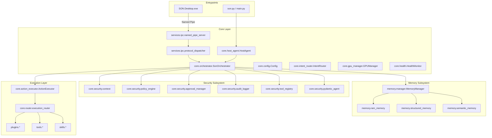

# DEPENDENCY_MAP.md — SON V3 Dependency Map and Module Consolidation Plan

**Project**: SON V3 — Personal Computer Agent  
**Platform**: Windows 11 (Python 3.13.6, .NET 8.0 SDK)  
**Date**: November 14, 2026

---

## 1. External Dependencies Overview

### 1.1 Python Runtime Dependencies
| Package | Version | Purpose | Hardware Role |
| :--- | :--- | :--- | :--- |
| `ollama` | Latest | Client for local Ollama daemon (`127.0.0.1:11434`) | LLM inference |
| `pydantic` | 2.x | Data validation and schema enforcement | Core schemas |
| `pydantic-ai` | Latest | Defensive agent framework with deferred tools | Security pipeline |
| `faster-whisper`| Latest | Speech-to-text with CT2 CUDA acceleration | GPU STT |
| `piper-tts` | Latest | Local text-to-speech with ONNX Runtime | Audio synthesis |
| `sounddevice` | Latest | PortAudio wrapper for real-time microphone capture | Audio capture |
| `openwakeword` | Latest | Low-overhead wake-word detection ("Hey SON") | CPU audio listener |
| `pynvml` | Latest | Direct NVIDIA Management Library bindings | GPU/VRAM telemetry |
| `psutil` | Latest | CPU, RAM, Disk, and Process monitoring | System monitoring |
| `chromadb` | Latest | L3 semantic vector database | Long-term memory |
| `pytesseract` | Latest | Local OCR text recognition | Screen reading |
| `fastapi` | Latest | REST API and WebSocket event streaming | Multi-client bridge |
| `uvicorn` | Latest | ASGI web server | Remote/Web gateway |
| `numba` | Latest | LLVM JIT compiler with AVX2 SIMD vectorization | Native audio/math |
| `comtypes` | Latest | Win32 COM interop for UIAutomationCore | Tier 3 UI automation |
| `pywinauto` | Optional | Windows GUI automation wrapper | Tier 3 UI automation |
| `mcp` / `fastmcp`| Latest | Model Context Protocol client/server SDK | Tier 1 tool protocol |

### 1.2 C# .NET 8 Desktop Dependencies (`SON.Desktop`)
- Target Framework: `net8.0-windows`
- UI Framework: Windows Presentation Foundation (WPF) with `WindowChrome`
- `Microsoft.Extensions.DependencyInjection` (8.0.0): IoC Container
- Native Win32 Interop: P/Invoke to `user32.dll` (`WM_NCHITTEST`, `HTMAXBUTTON` for Windows 11 Snap Layouts)
- Named Pipe IPC Client: High-throughput asynchronous length-prefixed protocol (`\\.\pipe\son_desktop_ipc`)

---

## 2. Internal Module Dependency Map

---

## 3. Duplicate Module Identification & Consolidation Strategy

During the baseline audit, five major duplications were identified between the legacy root directory and the modern `core/` architecture:

| Duplicate File 1 (Legacy) | Duplicate File 2 (Modern) | Analysis & Root Cause | Consolidation Action |
| :--- | :--- | :--- | :--- |
| `brain.py` (root, 699 lines) | `core/brain.py` (299 lines) | Root `brain.py` contains legacy Ollama client logic and manual tool invoking. `core/brain.py` contains newer Qwen3 configuration. Both duplicate prompt assembly. | Consolidate into `core/host_agent.py` and `core/model_manager.py`. Turn root `brain.py` into a thin backward-compatibility shim. |
| `commands.py` (root, 35KB) | `core/orchestrator.py` (811 lines) | Root `commands.py` handles regex-based command execution with direct system calls. `core/orchestrator.py` enforces zero-trust gating. | Route all legacy command handling through `core/orchestrator.py`. Deprecate direct execution in `commands.py`. |
| `config.py` (root, 364 lines) | `core/config.py` (421 lines) | Root `config.py` contains legacy flat constants. `core/config.py` contains strongly typed dataclasses and logging setups. | Unify into `core/config.py`. Make root `config.py` import all constants from `core/config.py` to prevent split configuration state. |
| `memory.py` (root, 342 lines) | `memory/manager.py` (120 lines) | Root `memory.py` is a monolithic ChromaDB wrapper. `memory/` contains the proper 3-layer architecture (RAM, SQLite, ChromaDB). | Direct all memory access through `memory/manager.py`. Keep root `memory.py` as an alias redirecting to `memory.manager`. |
| `tools/registry.py` | `core/security/tool_registry.py` | `tools/registry.py` is an unauthenticated legacy registry. `core/security/tool_registry.py` enforces Pydantic schemas and risk tiers. | Deprecate `tools/registry.py` in favor of `core/security/tool_registry.py`. |

---

## 4. Circular Dependency Audit & Safe Loading Architecture

The circular dependency between `plugins/` and `core/security/tool_registry.py` was resolved in earlier waves via `_DefensiveToolRegistryProxy`.
To maintain zero circular imports going forward:
1. **Dependency Inversion Principle**: Core abstractions (`SecurityContext`, `InterfaceRequest`, `RiskTier`) never import high-level plugins or adapters.
2. **Lazy Skill Registration**: Skills register with `DefensiveToolRegistry` during `initialize()` lifecycle calls, never during module import time.
3. **Configuration Isolation**: `core/config.py` has zero imports from other project modules, serving as the foundational leaf dependency.
