# IMPLEMENTATION_ROADMAP.md — SON V3 Transformation Roadmap

**Project**: SON V3 — Personal Computer Agent  
**Platform**: Windows 11 (Ryzen 7 7840HS, RTX 4060 8GB, 16GB RAM)  
**Execution Strategy**: Incremental, test-driven phases with zero regression gates.

---

## Roadmap Overview

```mermaid
flowchart LR
    P0[Phase 0: Baseline & Audit] --> P1[Phase 1: HostAgent & Core Refactoring]
    P1 --> P2[Phase 2: Windows OS Spine & Router Tiers 1-2]
    P2 --> P3[Phase 3: MCP Integration & Tool Schemas]
    P3 --> P4[Phase 4: Hybrid GUI Automation Tiers 3-4]
    P4 --> P5[Phase 5: Voice & Model Performance Governor]
    P5 --> P6[Phase 6: Visual Engine & Remote Interfaces]
    P6 --> P7[Phase 7: Hardening, Benchmarking & Packaging]
```

---

## Phase 0: Repository Audit and Baseline (CURRENT PHASE)

### Goals
- Fully inspect repository structure, existing models, and dependencies.
- Map and document existing duplicate modules and circular dependencies.
- Verify 100% test pass rate on both Python and .NET suites before any architectural modification.
- Establish baseline documentation and migration safety strategy.

### Deliverables
- [x] Comprehensive code audit of all root files, `core/`, `agents/`, `plugins/`, `tools/`, `memory/`, `services/`, and `SON.Desktop/`.
- [x] `CURRENT_ARCHITECTURE.md`: Complete current system audit.
- [x] `TARGET_ARCHITECTURE.md`: Complete target specification.
- [x] `IMPLEMENTATION_ROADMAP.md`: Detailed phase-by-phase execution plan.
- [x] `DEPENDENCY_MAP.md`: Dependency relationships and duplicate module resolution plan.
- [x] `SECURITY_MODEL.md`: Formal zero-trust security specifications.
- [x] `PERFORMANCE_BASELINE.md`: Hardware budgets, latency benchmarks, and profiling baselines.
- [x] Verification of 267 Python tests and 15 .NET tests passing cleanly.

### Readiness Gate for Phase 1
- Zero test failures across existing test suites.
- Architecture documents reviewed and committed.
- Safe rollback tag created in git.

---

## Phase 1: Core Refactoring & Unified HostAgent

### Goals
- Introduce `HostAgent` as the single central orchestration authority.
- Unify duplicated modules:
  - Migrate root `brain.py` and `commands.py` into unified `core/orchestrator.py` and `core/host_agent.py`.
  - Harmonize root `config.py` and `core/config.py` with backward compatibility shims.
  - Consolidate `tools/registry.py` and `core/security/tool_registry.py`.
- Standardize all inbound requests into `InterfaceRequest` and all outbound into `InterfaceResponse`.
- Introduce structured event bus for cross-subsystem telemetry and notifications.
- Maintain full compatibility with `SON.Desktop` Named Pipe IPC and `son.py` CLI.

### Key Milestones
1. Implement `core/host_agent.py` encapsulating intent routing, planning, tool selection, memory context, and permission checks.
2. Refactor `son.py` to route its conversational turns through `HostAgent`.
3. Eliminate duplicate configuration lookups by standardizing on `core/config.py`.
4. Add comprehensive unit tests in `tests/test_host_agent.py`.

### Readiness Gate for Phase 2
- All legacy commands execute identically or faster through `HostAgent`.
- 100% test suite passing (267+ tests).

---

## Phase 2: Windows OS Spine & Four-Tier Router (Tiers 1 & 2)

### Goals
- Implement the deterministic **Four-Tier Execution Router** (`core/router/execution_router.py`).
- Implement **Tier 1 (Native APIs)**:
  - Native Windows process management, window state control (`ctypes`/Win32), and direct filesystem APIs.
- Implement **Tier 2 (Controlled Shell & PowerShell)**:
  - Subprocess runner (`shell=False`) with argument validation, path allowlists, and execution timeouts.
  - Integration with Git, Docker CLI, VS Code CLI, and Python environment managers.
- Modularize OS adapters into `skills/windows/`, `skills/files/`, `skills/vscode/`, `skills/terminal/`, `skills/docker/`, `skills/git/`, and `skills/monitoring/`.

### Key Milestones
1. Build `ControlledPowerShellRunner` with strict allowlists and argument parsing.
2. Package `skills/windows/` and `skills/files/` with declarative `SKILL.md` manifests.
3. Migrate `plugins/windows.py` and `tools/windows_control.py` into unified skill modules without duplicate code.
4. Verify execution of VS Code workspace setup, dependency installation, and git commits.

### Readiness Gate for Phase 3
- Native file and process operations complete in <5ms.
- Controlled PowerShell runner intercepts disallowed commands and path escapes.
- Full test pass across OS skills.

---

## Phase 3: MCP (Model Context Protocol) Integration

### Goals
- Implement a first-class, lightweight MCP client in SON (`core/mcp/client.py`).
- Provide MCP server discovery and connection lifecycle management (stdio and SSE/HTTP).
- Dynamically convert MCP tool definitions into PydanticAI schemas registered with `HostAgent`.
- Provide optional detection and graceful fallback for Windows On-device Agent Registry (ODR).

### Key Milestones
1. Build `MCPManager` for server discovery and session lifecycle.
2. Implement MCP tool registration bridge mapping MCP schemas to `DefensiveToolRegistry`.
3. Add tests verifying MCP server connection, tool invocation, and disconnection recovery.

### Readiness Gate for Phase 4
- MCP tools execute through the central `HostAgent` and `PolicyEngine` with full audit logging.
- Missing or crashing MCP servers do not crash SON.

---

## Phase 4: Hybrid GUI Automation (Tiers 3 & 4)

### Goals
- Implement **Tier 3 (Windows UI Automation)**:
  - Integration with `comtypes` / `UIAutomationCore.dll` and `pywinauto`.
  - Accessible element query: AutomationId, Name, ClassName, ControlType.
  - Programmatic button clicking, text entering, and menu navigation.
- Implement **Tier 4 (Visual Computer Use)**:
  - Screen capture with OpenCV and DPI-aware coordinate mapping.
  - Local OCR and visual grounding fallback (using Llama 3.2 Vision / UI-TARS).
  - Strict action verification (pre-action vs post-action screen diff).

### Key Milestones
1. Implement `core/router/tier3_uia.py` for structural UI element navigation.
2. Implement `core/router/tier4_visual.py` for fallback coordinate visual computer use.
3. Add automated Windows UI test tasks (Notepad, File Explorer, Calculator).

### Readiness Gate for Phase 5
- Automated tasks verify outcomes without relying exclusively on blind coordinate clicks.
- Visual model is invoked only when Tiers 1-3 cannot fulfill the request.

---

## Phase 5: Voice Pipeline & AI Model Performance Governor

### Goals
- Centralize model management with dynamic VRAM routing on the RTX 4060.
- Ensure strict adherence to the 95% GPU ceiling and 8 GB VRAM budget.
- Optimize voice pipeline:
  - Fast VAD (Silero) + Streaming Whisper STT.
  - Low-latency Piper ONNX TTS with double buffering.
  - Multi-language support (English, Hindi, Hinglish).
- Benchmark latency: wake word to first audio output < 800ms.

### Key Milestones
1. Implement `core/model_manager.py` with on-demand Ollama model loading/unloading.
2. Integrate Silero VAD into `audio.py` for natural speech boundary detection.
3. Benchmark and optimize end-to-end voice latency.

### Readiness Gate for Phase 6
- Total VRAM usage never exceeds 7.6 GB under simultaneous voice + reasoning workloads.
- Zero audio buffer overruns or dropped frames.

---

## Phase 6: Visual Engine (Godot) & Remote Interfaces

### Goals
- Decouple visualization from core AI:
  - Create standardized WebSocket event channel on `127.0.0.1:8765`.
  - Standardized JSON events: `son_started`, `listening`, `transcription`, `thinking`, `tool_started`, `tool_completed`, `speaking`, `system_status`.
- Connect future Godot 3D holographic core HUD to WebSocket stream.
- Prepare FastAPI REST endpoints for future Flutter mobile companion with token authentication.

### Key Milestones
1. Implement `services/api/fastapi_gateway.py` with WebSocket event broadcaster.
2. Verify event stream delivery to desktop HUD and WebSocket clients.
3. Document mobile companion pairing and mTLS / token protocol.

### Readiness Gate for Phase 7
- WebSocket server runs with <1ms event broadcast latency.
- Disconnecting visual client causes zero impact to AI assistant core.

---

## Phase 7: Hardening, Automated Benchmarking & Packaging

### Goals
- Comprehensive security review and automated regression testing.
- Windows automation benchmark across 8 core workflows:
  1. File Explorer file management.
  2. Notepad document creation and editing.
  3. Browser navigation and search.
  4. VS Code workspace opening and git status.
  5. Docker container inspection.
  6. Windows Settings adjustments.
  7. System diagnostics and hardware telemetry.
  8. Voice message drafting with confirmation.
- One-click launcher (`SON.bat` and PowerShell launcher) and packaging.

### Key Milestones
1. Build end-to-end deterministic benchmark suite (`benchmarks/benchmark_pc_agent.py`).
2. Run security audit against prompt injection and path traversal vectors.
3. Final release documentation and deployment verification.
