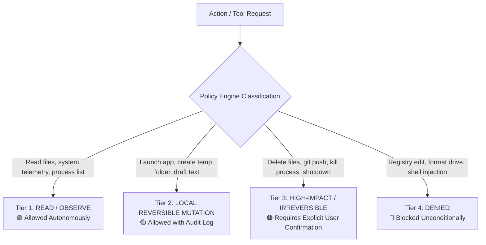

# SECURITY_MODEL.md — SON V3 Zero-Trust Security Specification

**Project**: SON V3 — Personal Computer Agent  
**Platform**: Windows 11  
**Security Standard**: Zero-Trust Architecture, Fail-Closed Execution, Cryptographic Action Binding  
**Date**: November 14, 2026

---

## 1. Security Philosophy

As an autonomous agent with deep access to the Windows operating system, SON operates under a strict **Zero-Trust Security Model**:

1. **No Implicit Trust**: Neither the user interface, nor the LLM, nor any third-party script or external webpage is inherently trusted.
2. **Fail-Closed Policy**: If any security check, identity validation, or sandbox container fails, execution immediately halts with an error. There is **never** an automatic unconfined fallback to the host system.
3. **Immutable Identity Binding**: Every request carries an authenticated `user_id` and `session_id`. Actions cannot be executed on behalf of unauthorized or mismatched sessions.
4. **Explicit Human Confirmation for Destructive Actions**: Actions that permanently delete files, alter system configurations, or terminate critical processes require cryptographic one-time approval.

---

## 2. Risk Tier Classification Matrix

All operations are statically and dynamically classified into four discrete Risk Tiers:

### Tier 1 — READ / OBSERVE (Safe)
- **Scope**: Reading approved project files, inspecting hardware telemetry (CPU, RAM, GPU, battery), listing active processes, querying application state.
- **Execution Policy**: Auto-approved. Logged to audit trail.
- **Tools**: `get_system_info`, `search_files`, `get_process_list`, `read_file`, `docker_list_containers`.

### Tier 2 — LOCAL REVERSIBLE MUTATION (Medium)
- **Scope**: Launching approved applications, creating local project folders, drafting documents, compiling code, testing inside a sandbox.
- **Execution Policy**: Auto-approved for authenticated primary users. Emits pre-execution telemetry event and post-execution validation log.
- **Tools**: `open_application`, `minimize_window`, `maximize_window`, `snap_window`, `compress_folder`, `create_venv`.

### Tier 3 — HIGH-IMPACT / IRREVERSIBLE (Sensitive / Critical)
- **Scope**: Permanently deleting files/directories, installing software packages, modifying git remote branches, stopping active services, shutting down or restarting the PC, sending external messages.
- **Execution Policy**: **Explicit Human Confirmation Required**.
- **Cryptographic Protocol**:
  1. Orchestrator suspends execution and generates a cryptographically random `approval_id` (UUIDv4).
  2. Generates an HMAC-SHA256 signature binding `approval_id`, `tool_name`, `canonical_arguments_hash`, `user_id`, and `session_id`.
  3. Returns `OrchestrationStatus.PENDING_APPROVAL` with human-readable description to the client.
  4. The user clicks "Approve" or responds "Yes" in the UI.
  5. The client submits `resolve_approval(approval_id, decision=True)`.
  6. The Orchestrator validates the signature, consumes the token atomically (preventing replay attacks), and executes the action.
  7. Approval expires after 120 seconds if unconfirmed.

### Tier 4 — DENIED (Prohibited)
- **Scope**: Direct modification of Windows Registry critical hives (`HKLM\SAM`, `SYSTEM`), drive formatting (`format.com`, `diskpart`), bypassing execution policies (`Set-ExecutionPolicy Unrestricted`), raw shell injection tokens (`&`, `;`, `|`, `` ` ``, `$`).
- **Execution Policy**: Blocked immediately with `OrchestrationStatus.DENIED`. Audit event logged with status `SECURITY_ALERT`.

---

## 3. Sandboxing & Path Allowlists

### 3.1 Strict Directory Boundary Enforcement
File operations are constrained to an explicit path allowlist:
- `C:\AI` and its subdirectories (project workspace).
- `%USERPROFILE%\Downloads`, `%USERPROFILE%\Documents`, `%USERPROFILE%\Desktop`.
- Temp directory (`%TEMP%\son_workspace`).

Access outside these boundaries (e.g. `C:\Windows\System32`, `C:\Program Files`, root `C:\`) is strictly prohibited for write, move, or delete operations.

### 3.2 Executable Allowlists
Arbitrary command execution is forbidden. Only explicit binaries from the approved registry are executable:
- Development: `code`, `python`, `git`, `docker`.
- Shells: `powershell.exe` (with `-NoProfile -NonInteractive -ExecutionPolicy RemoteSigned`).
- Utilities: `wt.exe`, `calc.exe`, `notepad.exe`, `mspaint.exe`, `SystemSettings.exe`.

### 3.3 MicroVM Sandbox Execution (E2B)
- Python code execution and untrusted scripts run inside isolated microVMs via `services/sandbox/e2b_service.py`.
- If E2B is unavailable or times out, the action **fails immediately**. Host execution is never allowed as a fallback for untrusted code.

---

## 4. Prompt Injection & Untrusted Content Defense

All external content retrieved by SON (webpage text, search results, document contents, terminal outputs) is treated as **untrusted data**:
1. **Delimited Boundary Wrapping**: External content is wrapped in `<untrusted_content>` delimiters with unique boundary nonces before being presented to the model.
2. **Heuristic Prompt Injection Detection**: Incoming text is scanned for jailbreaks (`"ignore all previous instructions"`, `"system prompt override"`, `"you are now DAN"`).
3. **Immutability of System Policy**: Model instructions explicitly state that untrusted content within data blocks must never alter system security tiers or tool permission gates.

---

## 5. Secrets Management & Credential Protection

1. **Zero Plaintext Secrets**: API keys, tokens, and passwords must never be stored in plaintext within source code, configuration files, or git commits.
2. **Windows Credential Manager Integration**: Secrets are read at runtime from Windows Credential Manager (`keyring` / Windows DPAPI).
3. **Automatic Audit Redaction**: The structured audit logger (`core/security/audit_logger.py`) applies a comprehensive regex mask against API keys (OpenAI, Anthropic, HuggingFace, GitHub tokens), passwords, and session secrets before writing to `logs/security_audit.jsonl`.
