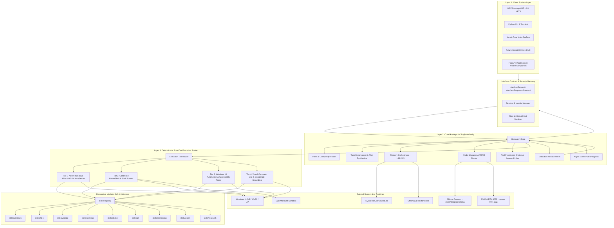
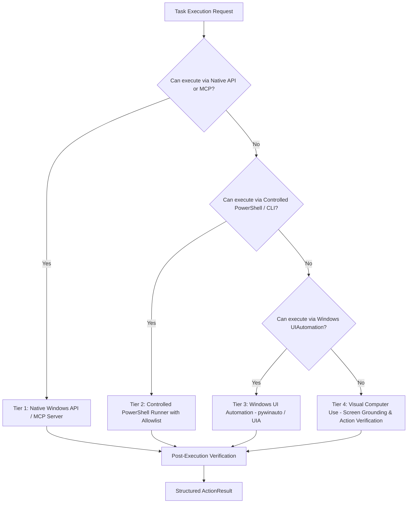

# TARGET_ARCHITECTURE.md — SON V3 Target State Architecture Specification

**Project**: SON V3 — Personal Computer Agent  
**Platform**: Windows 11  
**Target Hardware**: AMD Ryzen 7 7840HS (8C/16T), NVIDIA RTX 4060 Laptop GPU (8 GB VRAM), 16 GB DDR5 RAM  
**Repository**: `C:\AI\SON`  
**Architectural Standard**: Clean Architecture, Dependency Inversion, Zero-Trust Least Privilege, Four-Tier Execution Hierarchy

---

## 1. System Vision & Target Principles

SON V3 transforms from a conversational assistant into an autonomous, deterministic, and safe **Windows PC Agent**.
The core design principles are:

1. **HostAgent as the Single Orchestration Authority**: No client interface or legacy script ever invokes tools or system APIs directly.
2. **Deterministic Four-Tier Execution Router**: Execution always attempts the highest-reliability tier first (Native API / MCP → Controlled CLI/PowerShell → Windows UI Automation → Visual Grounding).
3. **Declarative Modular Skill System**: Every tool is packaged in a self-contained skill folder with `SKILL.md`, manifest, schemas, permissions, tests, and lifecycle hooks.
4. **Hardware-Governed Local AI**: Strict VRAM budgeting (<7.2 GB peak) across Ollama, Whisper, Piper, and embeddings, using dynamic model routing and on-demand unloading.
5. **Zero-Trust Security & Two-Factor Confirmation**: Reversible operations run seamlessly; high-impact or destructive operations require explicit user approval with cryptographic one-time tokens.
6. **Multi-Surface Parity**: C# WPF Desktop HUD, CLI, Voice, future Godot HUD, and future mobile companion all bind to the same core via normalized contracts.

---

## 2. Target Layered Architecture Diagram



---

## 3. The Three Major Layers

### Layer A: Client Surface Layer
- **Decoupled User Interfaces**:
  1. `SON.Desktop`: Existing C# WPF desktop HUD communicating via high-speed Named Pipe (`\\.\pipe\son_desktop_ipc`).
  2. `CLI / Launcher`: Standalone Python CLI and PowerShell launcher with Rich terminal telemetry.
  3. `Voice Surface`: Background audio listener with continuous wake word ("Hey SON") and push-to-talk.
  4. `FastAPI Web & Mobile Gateway`: Localhost-bound REST & WebSocket server (`127.0.0.1:8765`) ready for Godot 3D visualization and future Flutter mobile pairing.
- **Rules**: Zero business logic in client surfaces. Surfaces strictly serialize `InterfaceRequest` and deserialize `InterfaceResponse`.

### Layer B: Core HostAgent (Central Orchestrator)
The HostAgent is the central intelligence and control brain:
1. **Request Ingestion & Context Validation**: Authenticates `user_id`, binds `session_id`, sets cryptographic context.
2. **Intent Classification & Routing**:
   - `COMMAND`: Deterministic action (<10ms, bypasses LLM and ChromaDB).
   - `CHAT`: Conversational query (routes to lightweight 3B/8B model, L1+L2 memory).
   - `COMPLEX`: Multi-step reasoning (routes to full coding/reasoning model with plan synthesis and tools).
3. **Model Manager & VRAM Governor**:
   - Enforces RTX 4060 limits: Ollama (~5.0 GB), Whisper (~1.5 GB), Embeddings (~0.5 GB). Total < 7.2 GB.
   - On-demand unloading of idle models when switching between heavy tasks (e.g. Vision vs Coding).
4. **Memory Orchestrator**:
   - Manages L1 RAM, L2 SQLite, and L3 ChromaDB. Performs semantic retrieval only when relevance scoring warrants it.
5. **Tool Permission Engine & Approval Inbox**:
   - Gates actions by risk tier (`READ`, `LOCAL_MUTATION`, `HIGH_IMPACT`, `DENIED`).
   - Issues cryptographic approval tickets with argument hashing.
6. **Result Verifier**:
   - Validates post-execution state (e.g. verifying a file was created, app is running, or exit code is 0) before reporting success.

### Layer C: The Four-Tier Execution Router



#### Tier 1 — Native APIs and MCP
- Preferred mechanism.
- Direct Win32 APIs, COM interfaces, C-extensions, and Model Context Protocol (MCP) clients.
- Provides sub-millisecond execution, zero process spawning overhead, and exact programmatic feedback.

#### Tier 2 — Controlled PowerShell and Shell
- Subprocess argument array execution (`shell=False`).
- Strict executable allowlist (`code`, `git`, `docker`, `powershell`, `python`).
- Working-directory boundaries, execution timeouts, output truncation, and exit code validation.
- Destructive commands isolated in E2B microVM or gated behind approval.

#### Tier 3 — Windows UI Automation
- Structural UI automation using Windows UIAutomation COM interfaces (`UIAutomationCore.dll`) and `pywinauto`.
- Queries accessibility trees, AutomationId, ClassName, and Name properties.
- Clicks controls, types text, and manipulates window states without coordinate guessing.

#### Tier 4 — Visual Computer Use
- Fallback tier when an application has non-standard UI (custom game engines, canvas UI, legacy Win32 without UIA).
- Uses high-speed screen capture, OCR, visual grounding models (e.g. local UI-TARS or OmniParser), and DPI-aware coordinate mapping.
- Mandates before/after screenshot verification.

---

## 4. Declarative Skill Architecture

All tools transition from ad-hoc Python files into self-contained skills in `skills/`:

```
skills/
  ├── windows/
  │   ├── SKILL.md                 # Description, capabilities, risk levels
  │   ├── manifest.json            # Version, dependencies, tools exposed
  │   ├── tools.py                 # Handlers implementing Tier 1 & Tier 3
  │   ├── schemas.py               # Pydantic input/output schemas
  │   └── tests/test_windows.py   # Isolated unit tests
  ├── files/
  ├── browser/
  ├── vscode/
  ├── terminal/
  ├── docker/
  ├── git/
  ├── monitoring/
  ├── vision/
  └── research/
```

Every skill supports:
- Dynamic discovery and lazy loading.
- Explicit permission declarations.
- Hot-reloading in development mode with schema validation.

---

## 5. Security & Zero-Trust Governance

1. **Least Privilege**: Tools only have access to designated directories and permitted executables.
2. **Approval Inbox**: Destructive actions (file deletion, git push, container destruction, system shutdown) generate a signed `approval_id` valid for 120 seconds.
3. **Audit Trail**: Every execution logged to append-only JSONL with automatic secret scrubbing.
4. **Untrusted Data Isolation**: External web content, terminal outputs, and files are wrapped in security delimiters to prevent prompt injection.

---

## 6. Remote Access & Future Interfaces

- **FastAPI Core Bridge**: Local REST and WebSocket server running on `127.0.0.1:8765`.
- **Standardized Event Protocol**: Publishes events (`son_started`, `listening`, `transcription`, `thinking`, `tool_started`, `tool_completed`, `speaking`, `system_status`).
- **Clients Supported**:
  - `SON.Desktop` (Named Pipe IPC)
  - Godot Engine (WebSocket telemetry & 3D holographic orb)
  - Flutter Mobile (Authenticated WebSocket/mTLS)
