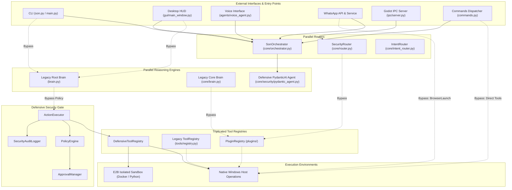
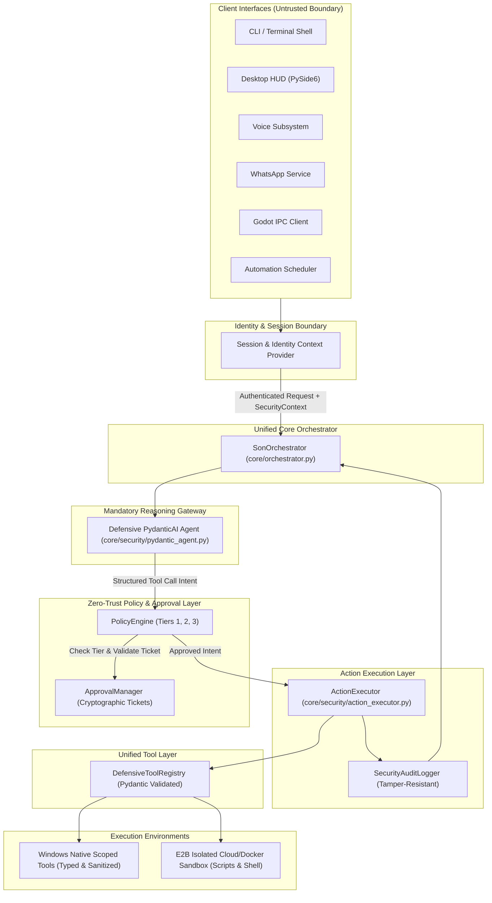
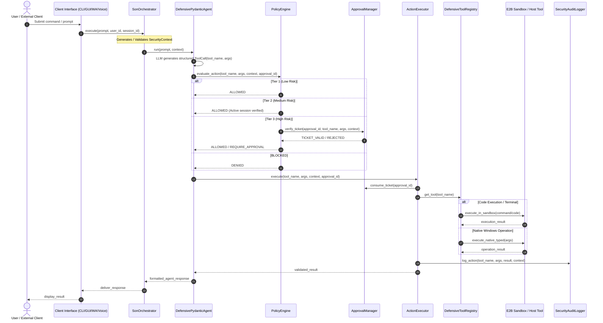
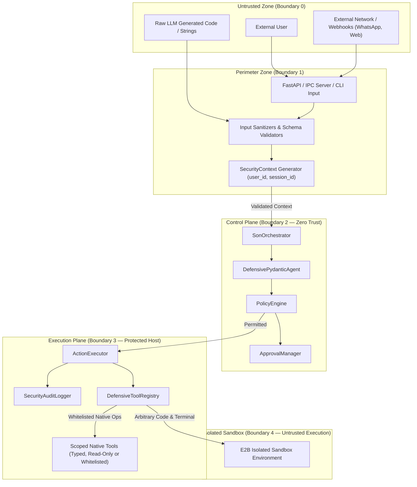
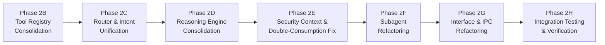

# SON V3 — PHASE 2A: COMPLETE ARCHITECTURE AUDIT
**Date**: November 9, 2026  
**Auditor**: Principal Software Architect & AI Security Engineer  
**Status**: Completed — Baseline for Phase 2 Implementation  
**Target Repository**: `C:\AI\SON`  

---

## 1. Executive Summary

Following the successful completion and verification of Phase 1 and Phase 1.5 Security Hardening (120/120 tests passing in `tests/test_security_defenses.py`), this architecture audit analyzes the structural integrity of SON V3 before beginning Phase 2 (Unified Orchestration Architecture).

The primary objective of Phase 2 is to transform SON V3 from a collection of fragmented, overlapping entry points, routers, and brains into a unified, zero-trust system where the **Defensive PydanticAI Agent is the mandatory gateway** for all AI-initiated actions, and every tool execution passes through the **PolicyEngine**, **ApprovalManager**, and **ActionExecutor**.

### Key Findings Overview
1. **PydanticAI Defensive Agent is NOT Currently the Mandatory Gateway**: Although `core/security/pydantic_agent.py` implements structured defensive tool-calling, three parallel legacy reasoning engines (`brain.py`, `core/brain.py`, and `core/async_brain.py`) bypass it entirely.
2. **Multiple Direct Tool Calling Bypasses**: Eight (8) distinct pathways exist where AI agents, subagents, or interfaces call tools or execute operations without passing through `ActionExecutor` or `PolicyEngine`.
3. **Triplication of Core Components**:
   - **Three Tool Registries**: `core.security.tool_registry.DefensiveToolRegistry`, `tools.registry.ToolRegistry`, and `plugins.PluginRegistry`.
   - **Three Routers**: `core.orchestrator.SonOrchestrator`, `core.router.SecurityRouter`, and `core.intent_router.IntentRouter`.
   - **Three Brains**: Root `brain.py` (legacy Ollama), `core.brain.py` (legacy hybrid), and `core.async_brain.py` (async Ollama).
4. **Tool Duplication**: Parallel implementations of core functionality exist between `tools/` and `plugins/` (e.g., Docker control, Windows process operations, Browser/Web search).
5. **Security Context Propagation Gaps**: When `ActionExecutor.execute()` is called without explicit caller context, it falls back to hardcoded default values (`son_desktop_user` / `son_desktop_session`). Furthermore, `ApprovalManager.verify_and_consume()` permits calls where `user_id` or `session_id` are omitted (`None`), degrading tenant/session binding.
6. **Double-Consumption Hazard**: `PolicyEngine.evaluate_action()` consumes approval tickets during policy evaluation via `approval_manager.verify_and_consume()`, preventing any subsequent executor from verifying the ticket without triggering a replay-attack failure.

---

## 2. Inventory of Entry Points and Interfaces

The audit inspected all entry points into the SON V3 ecosystem:

| Entry Point | Location | Description | Current Execution Route | Target Phase 2 Route |
| :--- | :--- | :--- | :--- | :--- |
| **CLI / Son App** | `son.py`, `main.py`, `launch_son.py` | Terminal interactive shell and core CLI | `son.py` -> `core/orchestrator.py` or root `brain.py` | `son.py` -> `SonOrchestrator` -> `DefensivePydanticAgent` |
| **Desktop UI / HUD** | `gui/main_window.py`, `run_hud.py` | PySide6 / PyQt desktop HUD interface | Calls root `brain.py` or `core/orchestrator.py` | UI -> `SonOrchestrator` -> `DefensivePydanticAgent` |
| **Voice Interface** | `agents/voice_agent.py`, `core/voice/` | Speech-to-text / Audio pipeline | Emits text to `son.py` / `brain.py` | Voice -> `SonOrchestrator` -> `DefensivePydanticAgent` |
| **WhatsApp Service** | `services/whatsapp/service.py`, `services/whatsapp/api.py` | Webhook API & messaging bridge | `service.py` uses `global_orch.execute_action`, but `api.py:118` executes direct browser launch | WhatsApp -> `SonOrchestrator` -> `DefensivePydanticAgent` |
| **Godot Frontend IPC** | `ipc/server.py`, `godot_frontend/scripts/son_ipc.gd` | TCP JSON-RPC server on `127.0.0.1:8765` | Receives JSON-RPC commands, forwards to `core/router.py` | IPC -> `SonOrchestrator` -> `DefensivePydanticAgent` |
| **Automation Scheduler**| `tools/automation.py`, `core/scheduler/` | Scheduled background task runner | Step runner calls `ActionExecutor`, but `commands.py` executes directly | Scheduler -> `ActionExecutor` (with strict SecurityContext) |
| **Commands Dispatcher**| `commands.py` | Pattern-matching system command handler | Direct calls to `tools.web`, `tools.docker_control`, etc. | `commands.py` -> `SonOrchestrator` -> `ActionExecutor` |
| **Individual Subagents**| `agents/*_agent.py` | Subagents for desktop, terminal, internet, vision, memory | Directly invoke `plugins.call()` or `sandbox_service` | Subagents -> `SonOrchestrator` / `ActionExecutor` |

---

## 3. Tool Invocation Paths & Bypass Catalog

### Detailed Analysis of Identified Bypasses

#### Finding B-01: Direct Plugin Execution in `core/brain.py` (CRITICAL)
- **File**: `core/brain.py`, Line 228
- **Code**: `result = self.plugins.call(fn_name, fn_args)`
- **Mechanism**: The legacy `Brain` uses Ollama tool calling. When the LLM emits a tool call, `core/brain.py` directly executes `self.plugins.call()`. This calls `PluginRegistry.call()`, which runs `tool["func"](**args)` without calling `PolicyEngine.evaluate_action()`, without checking `ApprovalManager`, and without logging to `SecurityAuditLogger`.
- **Remediation**: Deprecate `core/brain.py` tool execution. Route all LLM tool calls through `DefensivePydanticAgent` and `ActionExecutor`.

#### Finding B-02: Direct Plugin Dispatch in `core/router.py` (CRITICAL)
- **File**: `core/router.py`, Line 84
- **Code**: `return self.plugins.call(tool_name, arguments)`
- **Mechanism**: `SecurityRouter.dispatch_tool()` performs an internal `can_call_tool()` check, but then directly invokes `self.plugins.call()`. It completely bypasses `ActionExecutor`, `PolicyEngine` tier evaluations, approval ticket verification, and E2B sandboxing.
- **Remediation**: Consolidate `core/router.py` into `core/orchestrator.py`. Ensure all tool execution requests are handed off to `ActionExecutor`.

#### Finding B-03: Direct Plugin Calls in `agents/desktop_agent.py` (HIGH)
- **File**: `agents/desktop_agent.py`, Lines 19, 20, 22
- **Code**:
  ```python
  self.plugins.call("open_application", {"app_name": ...})
  self.plugins.call("docker_list_containers")
  ```
- **Mechanism**: `DesktopAgent` invokes `self.plugins.call()` directly without constructing a `SecurityContext` or passing through `ActionExecutor`.
- **Remediation**: Refactor `DesktopAgent` to submit requests to `SonOrchestrator.execute_action()` with authenticated session and user IDs.

#### Finding B-04: Direct Search & Plugin Calls in `agents/internet_agent.py` (MEDIUM)
- **File**: `agents/internet_agent.py`, Lines 23, 36
- **Code**: Raw DuckDuckGo searches and `self.plugins.call("get_weather", ...)`.
- **Mechanism**: Performs outbound network queries directly without policy auditing or rate limiting, and calls plugins directly.
- **Remediation**: Route web searches through a vetted `web_search` defensive tool registered in `DefensiveToolRegistry`.

#### Finding B-05: Direct Sandbox Invocation in `agents/terminal_agent.py` (HIGH)
- **File**: `agents/terminal_agent.py`, Line 67
- **Code**:
  ```python
  result = sandbox_service.execute_terminal_command(
      command=command,
      user_id=self.user_id,
      session_id=self.session_id,
  )
  ```
- **Mechanism**: Although `TerminalAgent` uses `sandbox_service` (satisfying the Phase 1 requirement that host command execution is prohibited), it completely bypasses `SonOrchestrator`, `PolicyEngine`, and `ActionExecutor`. It does not verify approval tokens or log through `ActionExecutor`.
- **Remediation**: Route terminal command execution as a registered tool `execute_terminal_command` through `ActionExecutor` under Tier 2/Tier 3 policy rules.

#### Finding B-06: Direct Browser Launch in `services/whatsapp/api.py` (HIGH)
- **File**: `services/whatsapp/api.py`, Line 118
- **Code**: `BrowserLauncher.open_draft_url(url)` in `/message/confirm` route.
- **Mechanism**: Unlike `services/whatsapp/service.py` which properly routes through `global_orch.execute_action("open_browser_url", ...)`, the HTTP confirmation endpoint directly triggers native host browser execution.
- **Remediation**: Update `/message/confirm` in `api.py` to route through `SonOrchestrator.execute_action()`.

#### Finding B-07: Unprotected Direct Calls in `commands.py` (HIGH)
- **File**: `commands.py`, Lines 497, 504, 510, 516, 522, 533, 555, 559
- **Code**: Direct calls to `tools.web.open_website()`, `tools.web.search_website()`, `tools.docker_control.docker_start()`, `tools.docker_control.docker_stop()`, `tools.automation.run_routine()`.
- **Mechanism**: `commands.py` contains a pattern-matching dispatch system. While PC control commands (`lock_pc`, `shutdown_pc`, `set_volume`) were migrated to `_execute_tool_safe()` in Phase 1, Web and Docker commands remain direct native function calls.
- **Remediation**: Migrate all web, docker, and routine commands in `commands.py` to call `ActionExecutor` via `SonOrchestrator`.

#### Finding B-08: Legacy `ActionExecutor` Invocation in Root `brain.py` (HIGH)
- **File**: `brain.py`, Line 537
- **Code**:
  ```python
  exec_res = self._action_executor.execute(
      tool_name=tool_name,
      arguments=arguments,
      approval_id=approval_id,
      context=None
  )
  ```
- **Mechanism**: Root `brain.py` maintains an internal `ToolRegistry` and calls `ActionExecutor.execute()` directly, bypassing `SonOrchestrator`, `DefensivePydanticAgent`, and `PolicyEngine`. Crucially, it passes `context=None`, which triggers fallback default IDs rather than verifying caller identity.
- **Remediation**: Unify `brain.py` with `core/orchestrator.py` and `DefensivePydanticAgent`. Pass fully validated `SecurityContext`.

---

## 4. Security Services & Zero-Trust Architecture Review

### 4.1 PolicyEngine (`core/security/policy_engine.py`)
- **Tiers**:
  - `TIER 1 (Low)`: Read-only operations (e.g., `get_system_metrics`, `list_files`). Auto-allowed.
  - `TIER 2 (Medium)`: Modifying operations (e.g., `open_application`, `kill_process`). Requires active session.
  - `TIER 3 (High)`: Sensitive / state-altering operations (e.g., `docker_stop`, `lock_pc`, `execute_terminal_command`). Requires explicit approval token.
  - `BLOCKED`: Forbidden operations (e.g., arbitrary host shell execution). Denied immediately.
- **Vulnerability Identified (Double Consumption Hazard)**:
  In `PolicyEngine.evaluate_action()`:
  ```python
  approval_status = self.approval_manager.verify_approval(
      approval_id, tool_name, arguments, user_id=user_id, session_id=session_id
  )
  ```
  `verify_approval()` calls `approval_manager.verify_and_consume()`, transitioning the approval ticket to `CONSUMED`. If an orchestrator or downstream executor subsequently verifies the ticket, it is rejected as already consumed.
  - **Fix**: Separate ticket inspection (`peek_approval` or `validate_ticket`) from consumption (`consume_ticket`), or ensure consumption occurs once and only once at the point of physical execution inside `ActionExecutor`.

### 4.2 ApprovalManager (`core/security/approval_manager.py`)
- **Status**: Implements cryptographically bound approval tokens with canonical JSON argument hashing and 5-minute expiration.
- **Vulnerability Identified (Optional ID Check)**:
  `verify_and_consume()` contains:
  ```python
  if user_id is not None and approval.user_id != user_id:
      return False
  if session_id is not None and approval.session_id != session_id:
      return False
  ```
  If a caller passes `user_id=None` or `session_id=None`, identity matching is bypassed.
  - **Fix**: Require non-empty `user_id` and `session_id` in `verify_and_consume()`. Fail closed if either parameter is missing.

### 4.3 ActionExecutor (`core/security/action_executor.py`)
- **Status**: Provides centralized execution, wrapping tool execution in policy verification and audit logging.
- **Vulnerability Identified (Context Fallback Default)**:
  `ActionExecutor.execute()` contains:
  ```python
  if context is None:
      context = SecurityContext(
          user_id="son_desktop_user",
          session_id="son_desktop_session",
          ...
      )
  ```
  When callers do not supply a `SecurityContext`, arbitrary code can trigger actions under the default identity.
  - **Fix**: Make `context` a mandatory parameter for all external and agent invocations.

### 4.4 Tool Registry Fragmentation
The repository currently maintains three distinct tool registries:
1. `core.security.tool_registry.DefensiveToolRegistry`: Pydantic-validated, type-safe, tier-aware schema definitions. Used by `DefensivePydanticAgent`.
2. `tools.registry.ToolRegistry`: Legacy registry holding unvalidated Python callables. Used by root `brain.py`.
3. `plugins.PluginRegistry`: Dynamic plugin registry holding raw functions. Used by `core/brain.py` and `core/router.py`.

**Remediation**: Consolidate all tools into `DefensiveToolRegistry`. Convert legacy tools and plugins into registered defensive tools with explicit input models and risk tier classifications.

---

## 5. Architectural Diagrams

### 5.1 Current Architecture (Showing Fragmentation and Bypasses)



---

### 5.2 Target Unified Architecture (Phase 2 Target)



---

### 5.3 Interface-to-Tool Execution Sequence Diagram



---

### 5.4 Security and Trust Boundary Diagram



---

## 6. Comprehensive Findings Catalog & Risk Classifications

| ID | Component | Finding Description | Severity | Impact |
| :--- | :--- | :--- | :--- | :--- |
| **SEC-01** | `core/brain.py` | Direct invocation of `self.plugins.call()` without policy evaluation or audit logging. | **CRITICAL** | LLM tool calls can trigger arbitrary registered plugins with zero authorization. |
| **SEC-02** | `core/router.py` | Direct tool execution via `self.plugins.call()` bypassing `ActionExecutor`. | **CRITICAL** | IPC and routed commands execute without tier checking, approval tokens, or logging. |
| **SEC-03** | `core/security/pydantic_agent.py` | PydanticAI defensive agent is not the mandatory gateway; parallel brains operate independently. | **HIGH** | Legacy brains invoke unverified actions without structured schema validation. |
| **SEC-04** | `commands.py` | Direct execution of web and Docker commands bypassing `ActionExecutor`. | **HIGH** | Users or automated commands bypass policy checks for container operations. |
| **SEC-05** | `services/whatsapp/api.py` | Confirmation endpoint `/message/confirm` directly invokes `BrowserLauncher.open_draft_url()`. | **HIGH** | Unauthenticated HTTP requests can force host browser URL launches. |
| **SEC-06** | `agents/terminal_agent.py` | Bypasses `SonOrchestrator` and `ActionExecutor` by calling `sandbox_service` directly. | **HIGH** | Terminal commands are executed without policy tier checks or approval validation. |
| **SEC-07** | `core/security/policy_engine.py` | Approval tickets consumed during `evaluate_action()`, causing double-consumption replay failures. | **HIGH** | Valid approved requests fail when `ActionExecutor` attempts to verify the ticket. |
| **SEC-08** | `core/security/action_executor.py` | Defaults to hardcoded `son_desktop_user` if `context=None`. | **MEDIUM** | Unauthenticated callers execute actions under the default identity. |
| **SEC-09** | `core/security/approval_manager.py` | `verify_and_consume()` permits `user_id=None` and `session_id=None`. | **MEDIUM** | Weakens user and session binding if caller omits identity arguments. |
| **SEC-10** | Repository Architecture | Triplication of Tool Registries (`DefensiveToolRegistry`, `ToolRegistry`, `PluginRegistry`). | **MEDIUM** | Inconsistent schema validation, fragmentation, and synchronization errors. |
| **SEC-11** | Repository Architecture | Triplication of Routers (`SonOrchestrator`, `SecurityRouter`, `IntentRouter`). | **MEDIUM** | Redundant routing logic and conflicting security enforcement paths. |
| **SEC-12** | Repository Architecture | Triplication of Brains (`brain.py`, `core/brain.py`, `core/async_brain.py`). | **MEDIUM** | Divergent prompt templates, unstructured tool calls, and unmaintained code. |

---

## 7. Inventory of Files Requiring Modification in Phase 2

The following files require targeted modification or consolidation across Phase 2:

### Core Security & Orchestration
1. `core/orchestrator.py`: Integrate `DefensivePydanticAgent` as the mandatory reasoning engine; absorb routing logic from `core/router.py`.
2. `core/security/pydantic_agent.py`: Bind all tool execution strictly through `ActionExecutor` with mandatory `SecurityContext`.
3. `core/security/policy_engine.py`: Fix double-consumption hazard by separating ticket validation from consumption.
4. `core/security/approval_manager.py`: Enforce non-null `user_id` and `session_id` in `verify_and_consume()`.
5. `core/security/action_executor.py`: Require non-null `SecurityContext`; disallow default fallback identity.
6. `core/security/tool_registry.py`: Migrate all useful legacy tools and plugins into `DefensiveToolRegistry`.

### Deprecations & Consolidations
7. `core/router.py`: Deprecate and route all requests through `core/orchestrator.py`.
8. `core/intent_router.py`: Integrate intent classification directly into `SonOrchestrator`.
9. `core/brain.py` & `core/async_brain.py`: Deprecate; redirect calls to `SonOrchestrator`.
10. `brain.py`: Deprecate legacy tool calling; redirect `process_query()` to `SonOrchestrator`.
11. `tools/registry.py`: Deprecate in favor of `DefensiveToolRegistry`.
12. `plugins/__init__.py`: Deprecate in favor of `DefensiveToolRegistry`.

### Agents & Dispatchers
13. `agents/desktop_agent.py`: Replace `self.plugins.call()` with calls to `SonOrchestrator`.
14. `agents/internet_agent.py`: Replace direct calls with defensive web tools.
15. `agents/terminal_agent.py`: Route terminal commands through `ActionExecutor` via `SonOrchestrator`.
16. `commands.py`: Replace direct tool invocations with `_execute_tool_safe()` or `SonOrchestrator`.
17. `services/whatsapp/api.py`: Route browser launches through `SonOrchestrator`.
18. `ipc/server.py`: Route incoming JSON-RPC calls through `SonOrchestrator`.

---

## 8. Implementation Roadmap (Phases 2B through 2H)



### Phase 2B — Tool Registry Consolidation
- Consolidate `tools/registry.py` and `plugins/__init__.py` into `core.security.tool_registry.DefensiveToolRegistry`.
- Ensure every tool has a Pydantic schema, strict type annotations, risk tier assignment, and sanitization.
- Eliminate duplicated implementations between `tools/` and `plugins/`.

### Phase 2C — Router & Intent Unification
- Unify `core/router.py`, `core/intent_router.py`, and `core/orchestrator.py` into a single authoritative `SonOrchestrator`.
- Establish standard request routing: `Interface -> SonOrchestrator -> Intent Classification -> Reasoning Engine / ActionExecutor`.

### Phase 2D — Reasoning Engine Consolidation
- Make `DefensivePydanticAgent` the primary reasoning engine for SON V3.
- Deprecate unstructured tool execution in `brain.py`, `core/brain.py`, and `core/async_brain.py`.
- Ensure all LLM tool calls emit structured Pydantic models routed through `ActionExecutor`.

### Phase 2E — Security Context Hardening & Double-Consumption Fix
- Resolve the double-consumption bug in `PolicyEngine`: Policy evaluation validates ticket validity without consuming; consumption occurs exclusively within `ActionExecutor` immediately before tool execution.
- Enforce mandatory non-null `SecurityContext` across `ActionExecutor.execute()`.
- Enforce strict `user_id` and `session_id` presence in `ApprovalManager.verify_and_consume()`.

### Phase 2F — Subagent Refactoring
- Refactor `DesktopAgent`, `InternetAgent`, `TerminalAgent`, `VisionAgent`, `VoiceAgent`, and `MemoryAgent` so they do not execute tools directly.
- All subagents must request actions via `SonOrchestrator` or `ActionExecutor`.

### Phase 2G — External Interface & IPC Refactoring
- Update `services/whatsapp/api.py`, `commands.py`, `ipc/server.py`, and `gui/main_window.py` to route all operations exclusively through `SonOrchestrator`.

### Phase 2H — Comprehensive Integration Testing & Verification
- Develop comprehensive end-to-end integration tests in `tests/test_phase2_architecture.py`.
- Verify zero bypasses remain.
- Ensure 100% of tests pass across the entire test suite.

---

## 9. Conclusion

Phase 1 and 1.5 successfully eliminated dangerous host shell execution and introduced cryptographic approval bindings. However, the architectural fragmentation identified in this audit leaves multiple direct execution bypasses around `ActionExecutor`.

By implementing Phases 2B through 2H according to this roadmap, SON V3 will achieve a rock-solid, zero-trust architecture where no interface, subagent, or reasoning engine can bypass policy evaluation, approval checks, or audit logging.

