# SON Desktop — Phased Implementation Roadmap & Verification Gates

## 1. Roadmap Overview & Timeline

The transformation of SON V3 into the production **SON Desktop** application is organized into 13 structured, incremental phases. Each phase has strict entry criteria, detailed deliverables, and verifiable acceptance gates.

```mermaid
flowchart LR
    P0["Phase 0<br/>Audit & Plan"] --> P1["Phase 1<br/>Spec & Design"]
    P1 --> P2["Phase 2<br/>WPF Shell Foundation"]
    P2 --> P3["Phase 3<br/>Named Pipe IPC"]
    P3 --> P4["Phase 4<br/>AI Chat Streaming"]
    P4 --> P5["Phase 5<br/>Approval & Security UI"]
    P5 --> P6["Phase 6<br/>Voice & Whisper"]
    P6 --> P7["Phase 7<br/>Memory & RAG"]
    P7 --> P8["Phase 8<br/>Vision & Screen"]
    P8 --> P9["Phase 9<br/>PC Control Center"]
    P9 --> P10["Phase 10<br/>Automation Routines"]
    P10 --> P11["Phase 11<br/>Model & VRAM Center"]
    P11 --> P12["Phase 12<br/>Packaging & Distro"]
```

---

## 2. Phase-by-Phase Deliverables & Acceptance Criteria

### Phase 0 — Repository & Environment Audit (CURRENT PHASE - COMPLETED)
- **Deliverables**: Verification of .NET 8 SDK, Python 3.13 packages, Ollama models, and RTX 4060 GPU vitals. Creation of `docs/desktop/` architectural plans.
- **Acceptance Gate**: Clean audit report; 10 required architecture documents authored; 238/238 existing test suite passing; 0 production code regressions.

### Phase 1 — Product Specification & UI Architecture (COMPLETED)
- **Deliverables**: PRD, UI design system, MVVM component hierarchy, wireframes, and protocol specification.
- **Acceptance Gate**: Explicit alignment on WPF architecture, dark theme tokens, and IPC framing.

### Phase 2 — Desktop Application Foundation
- **Deliverables**:
  - Initialize C# .NET 8 WPF solution at `src/desktop/SonDesktop.sln`.
  - Implement Shell Window with 10-item left navigation rail, top header bar, and status bar.
  - Implement Midnight Dark theme styling, Segoe UI typography, and window controls (minimize, maximize, close).
  - Configure `CommunityToolkit.Mvvm` navigation store and dependency injection container.
- **Acceptance Gate**: Solution builds cleanly (`dotnet build`); desktop window launches and runs at 60 FPS; view navigation switches smoothly between 10 placeholder views with zero lag.

### Phase 3 — Backend Communication & Named Pipe IPC
- **Deliverables**:
  - Python asyncio Named Pipe server (`services/ipc/named_pipe_server.py`) listening on `\\.\pipe\son_desktop_ipc`.
  - C# .NET Named Pipe client service (`Services/NamedPipeIpcClient.cs`) with 4-byte length-prefixed framing.
  - Bidirectional handshake, 2-second heartbeat ping/pong, and process supervisor watchdog.
- **Acceptance Gate**: Desktop client and Python backend connect within 300ms; ping-pong latency < 5ms; killing Python process triggers automatic reconnect banner and clean restart.

### Phase 4 — AI Chat Integration
- **Deliverables**:
  - Connect `ChatViewModel` to backend `SonOrchestrator` via IPC.
  - Implement token-by-token character streaming for Ollama responses.
  - Rich Markdown presentation with Cascadia Code syntax highlighting and one-click code copy.
  - Collapsible "Thinking" reasoning expander panel.
  - Conversation thread history browser and persistent storage.
- **Acceptance Gate**: Real-time token streaming flows seamlessly without freezing the WPF UI thread; multi-line code blocks format cleanly; conversation history persists across restarts.

### Phase 5 — Security & Approval UI
- **Deliverables**:
  - Floating and embedded `ApprovalCard` component triggered by backend `APPROVAL_PROMPT_PUSH`.
  - Displays tool name, target path/arguments, risk tier (`HIGH`/`CRITICAL`), reason, and 120s countdown timer.
  - Approve & Deny buttons dispatching cryptographic token resolutions to `ApprovalManager`.
  - Live security audit stream viewer in Security Center displaying recent events and secret redaction badges.
- **Acceptance Gate**: High-risk tool calls (e.g. `delete_path`) immediately pop up the approval card; denying halts execution; approving triggers execution; replaying expired tokens is rejected.

### Phase 6 — Voice Assistant
- **Deliverables**:
  - NAudio capture pipeline with configurable push-to-talk hotkey (`Right Alt`).
  - Animated live soundwave / audio visualizer canvas responding to mic input volume.
  - Faster-Whisper GPU-accelerated speech-to-text pipeline.
  - Neural text-to-speech audio playback with instant cancel/interrupt (`Esc`).
- **Acceptance Gate**: Holding push-to-talk records audio; transcription renders within 800ms; speech synthesis speaks response clearly; pressing Esc instantly stops playback.

### Phase 7 — Memory & Knowledge Center
- **Deliverables**:
  - Memory Center UI displaying categorized episodic and factual memories.
  - Search bar with instant filtering across saved memories.
  - Manual memory addition modal and one-click memory deletion.
  - RAG document indexer status panel showing indexed documents and embedding status.
- **Acceptance Gate**: Memory cards populate from backend SQLite memory store; adding a memory persists immediately; sensitive tokens are scrubbed before indexing.

### Phase 8 — Vision Center
- **Deliverables**:
  - Explicit user-triggered screenshot capture (Full Screen, Active Window, or Drag Marquee).
  - Visual flash notification and preview thumbnail inspector.
  - Multimodal visual reasoning via `llama3.2-vision` or `qwen3-vl`.
  - One-click OCR text extraction panel with copy button.
- **Acceptance Gate**: Screen capture requires explicit button click (zero background covert capture); vision model accurately describes captured screen contents.

### Phase 9 — PC Control Center
- **Deliverables**:
  - Verified application launcher grid (VS Code, Chrome, Terminal, Obsidian, Spotify).
  - Scoped file explorer strictly confined to permitted workspace roots.
  - System volume slider and screen brightness control integration.
  - Docker container manager table (List, Start, Stop with approval gating).
- **Acceptance Gate**: Launching approved apps succeeds without shell execution; navigating outside allowed directories is visually blocked; stopping containers requests approval.

### Phase 10 — Automation Center
- **Deliverables**:
  - Automation routine dashboard listing active routines.
  - Routine step timeline showing execution progress.
  - Fail-safe step pausing: high-risk steps pause the routine and pop an approval notification.
  - Global emergency abort button cancelling all active routines.
- **Acceptance Gate**: Routine steps execute sequentially; approval pauses execution until Dad approves; abort stops routine immediately.

### Phase 11 — Model & Hardware Center
- **Deliverables**:
  - Ollama model management interface showing installed models, disk footprint, and parameter size.
  - One-click model switching with model unloading to prevent VRAM accumulation.
  - Hardware-aware recommendations flagging models exceeding the 6.0 GB VRAM allocation.
  - Live GPU compute and VRAM telemetry gauges (1Hz update).
- **Acceptance Gate**: Switching from `llama3.2` to `qwen2.5-coder` unloads the old model; VRAM meter reflects true GPU memory accurately; VRAM >85% triggers visual amber alert.

### Phase 12 — Finalization, Packaging & Distribution
- **Deliverables**:
  - Windows application icon, manifest, and system tray minimization.
  - Release build packaging (`dotnet publish -c Release -r win-x64 --self-contained`).
  - Python backend packaging with virtual environment bundling.
  - WiX or Inno Setup Windows installer script (`SON-Desktop-Setup.exe`).
  - End-to-end regression and security verification.
- **Acceptance Gate**: Clean install on Windows 11 machine without existing environment; installer configures startup shortcut; uninstall cleanly purges files; all security defenses pass.

