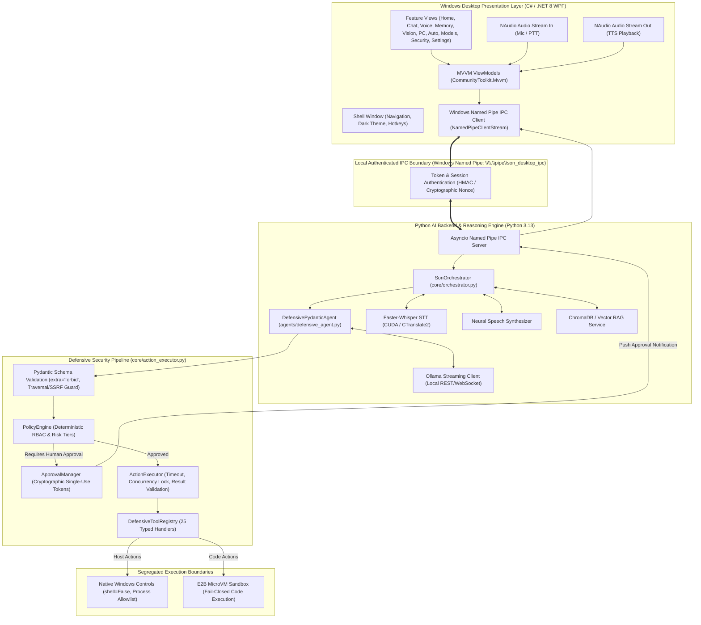
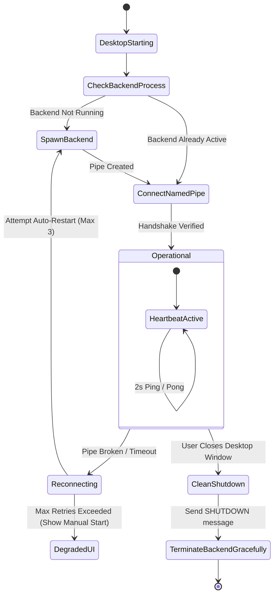

# SON Desktop — System Architecture & Technical Design

## 1. High-Level Architectural Diagram

---

## 2. Frontend Architecture (C# / .NET 8 WPF)

### Rationale for C# WPF (.NET 8):
1. **Host Environment Match**: The development laptop already has `.NET SDK 8.0.427` and `Microsoft.WindowsDesktop.App 8.0.33` installed. WPF provides 100% native Windows rendering, GPU hardware acceleration via DirectX 9/11, deep Windows API integration (P/Invoke for hardware, system volume, window enumeration), and mature MVVM tooling.
2. **Zero Overhead Web Runtimes**: Unlike Electron or Tauri, WPF does not require bundling a Chromium browser, keeping startup time < 600ms and memory usage < 120MB.
3. **Rock-Solid Windows Named Pipes**: .NET's `System.IO.Pipes` provides kernel-level Windows Named Pipe integration with Windows Access Control Lists (ACLs), ensuring zero network exposure and microsecond latency.

### Architectural Pattern: MVVM (Model-View-ViewModel)
- **Framework**: `CommunityToolkit.Mvvm` (Modern, compile-time source generators, zero reflection overhead).
- **Navigation Service**: Single-window shell hosting a dynamic `NavigationStore` with cached views.
- **Hardware Telemetry Provider**: Queries WMI and NVML (via P/Invoke or local JSON socket) to stream GPU temperature, VRAM usage, and CPU percentages at 1Hz without causing UI stutters.
- **Markdown & Syntax Highlighting**: Custom RichTextBox renderer converting backend Markdown AST into native WPF flow documents with syntax highlighting.

---

## 3. Backend Architecture (Python 3.13)

The Python backend remains the single source of truth for all intelligence, reasoning, memory, and security governance.

### Core Modules Reused:
1. **[`SonOrchestrator`](file:///C:/AI/SON/core/orchestrator.py)**: Central coordinator handling request lifecycles, prompt injection screening, and turn dispatch.
2. **[`DefensivePydanticAgent`](file:///C:/AI/SON/agents/defensive_agent.py)**: PydanticAI-powered reasoning agent generating structured tool intents.
3. **[`ActionExecutor`](file:///C:/AI/SON/core/action_executor.py)**: The hardened execution gateway enforcing input validation, execution timeouts, deduplication, and result validation.
4. **[`PolicyEngine`](file:///C:/AI/SON/core/security/policy_engine.py)**: Evaluates risk levels and gates high-risk tools behind explicit authorization.
5. **[`ApprovalManager`](file:///C:/AI/SON/core/security/approval_manager.py)**: Issues cryptographic single-use tickets bound to user, session, and argument hashes.
6. **[`DefensiveToolRegistry`](file:///C:/AI/SON/core/security/tool_registry.py)**: 25 strictly typed tool handlers.
7. **[`ResultValidator`](file:///C:/AI/SON/core/security/result_validator.py)**: Enforces 512KB size limits, credential scrubbing, and prompt injection defense.

---

## 4. Inter-Process Communication (IPC) Protocol

Communication between the C# desktop frontend and the Python backend operates over **Windows Named Pipes**:

- **Pipe Name**: `\\.\pipe\son_desktop_ipc`
- **Security Access Control (ACL)**: Restricted strictly to the local current Windows user security descriptor (`CurrentReadWrite`), blocking any unauthorized local processes or network access.
- **Message Format**: Length-prefixed JSON frames (`[4-byte big-endian length][UTF-8 JSON payload]`).
- **Communication Modes**:
  1. **Request-Response (Duplex)**: Standard commands, status queries, settings changes.
  2. **Push Streaming (Unidirectional from Backend)**: LLM token generation stream, live hardware telemetry, audio state changes, and pending approval notifications.

---

## 5. Execution Segregation: Host vs Sandbox

To guarantee workstation stability and prevent host compromise:
1. **AI-Generated Code**:
   - Must execute strictly inside an **isolated E2B MicroVM**.
   - If the E2B API key is missing or the sandbox service is unreachable, execution **fails closed** with a controlled error message.
   - Host fallback is permanently blocked by security policy.
2. **Native Desktop Controls**:
   - Bounded native tools (`open_application`, `close_application`, `set_volume`, `set_brightness`, `take_screenshot`, `shutdown_pc`).
   - Execute strictly with `shell=False`.
   - Destructive operations (`delete_path`, `close_application`, `shutdown_pc`) halt execution until approved via an interactive UI prompt.

---

## 6. Process Lifecycle & Watchdog Management

