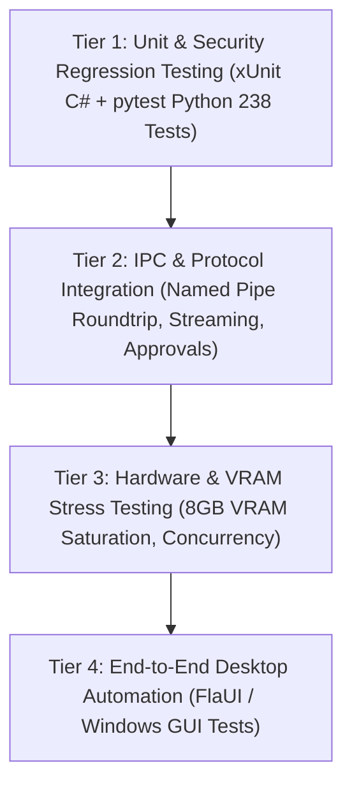

# SON Desktop — Comprehensive Testing Strategy

## 1. Multi-Tier Testing Pyramid

SON Desktop utilizes a multi-tiered quality assurance strategy spanning client-side unit testing, backend security regression, IPC integration harnesses, and hardware stress verification.

---

## 2. Test Tiers & Methodologies

### Tier 1: Unit & Defensive Security Regression (Python & C#)
- **Python Security Suite (238/238 existing tests)**:
  - Must run before and after every release build: `pytest tests/ -q`.
  - Verifies: `PolicyEngine`, `ApprovalManager`, `ActionExecutor`, `StrictToolParams`, directory traversal rejection (`..`), SSRF prevention, E2B fail-closed host execution blocking, and output size bounding.
- **C# Client Unit Tests (xUnit + Moq)**:
  - Test project: `src/desktop/SonDesktop.Tests`.
  - Verifies ViewModels, MVVM navigation routing, length-prefixed IPC byte framing serialization/deserialization, and markdown token parsing.

### Tier 2: IPC & Protocol Integration Testing
- **Named Pipe Integration Harness**:
  - Tests client connection establishment to `\\.\pipe\son_desktop_ipc`.
  - Validates bidirectional handshake, token generation streaming, heartbeat ping/pong (2s interval), and error frame delivery.
- **Approval Flow Integration**:
  - Automated test triggering a simulated high-risk tool call (`delete_path`), verifying `APPROVAL_PROMPT_PUSH` reaches the UI, asserting UI user approval submission, and checking backend execution completion.
- **Reconnection & Fault Tolerance**:
  - Deliberately terminating the Python backend process during active streaming; verifies C# client detects the pipe break, sets UI to `Reconnecting` state, and reconnects within 2 seconds upon backend restart.

### Tier 3: Hardware & VRAM Stress Testing (RTX 4060 8GB)
- **VRAM Saturation Test**:
  - Runs inference on `llama3.2:latest` (2.0 GB) and then switches to `llama3.2-vision:latest` (7.8 GB).
  - Asserts that previous model weights are unloaded from GPU memory before new model loads to prevent CUDA Out-Of-Memory (OOM) crashes.
- **Concurrency & Deduplication Load**:
  - Dispatches 10 concurrent requests across distinct sessions over the named pipe.
  - Verifies distinct session contexts, absence of thread deadlocks, and correct duplicate execution blocking.

### Tier 4: Desktop UI Automation (FlaUI)
- **WPF UI Automation Suite**:
  - Uses `FlaUI.UIA3` to automate Windows desktop interaction.
  - Verifies window launches, navigation sidebar switches views cleanly, chat input submits on `Enter`, and theme toggles update visual styles.

---

## 3. Continuous Verification Checklist

Every pull request or release milestone must pass:
1. `dotnet test src/desktop/SonDesktop.Tests` (100% pass).
2. `pytest tests/ -v` (all 238 tests pass).
3. `git diff --check` (0 trailing whitespace or line-ending errors).
4. Memory leak check: WPF UI memory footprint remains < 150 MB after 1,000 streamed chat messages.

